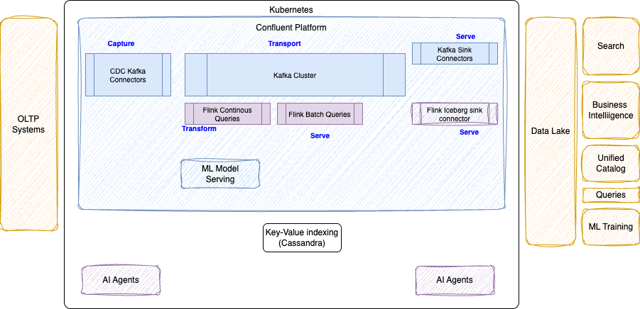

# Streamhouse on Confluent Platform

This note assess what needs to be done to run a Streamhouse on top of Confluent Platform. Streamhouse can be implemented on top of self managed products, for air-gapped and hybrid cloud architectures.

## Streamhouse Capabilities Mapped to CP

With self-managed platform some streamhouse capabilities need to be stiched together by architects and SREs.

<figure markdown='span'>

</figure>

* **Capture:** Ingest real-time database changes or operational events with Kafka connectors (100+ connectors), and Flink CDC directly from databases. In Confluent Platform connectors confugration is done via kubernetes custom resources. CP Flink supports CDC, JDBC, Filesystem connectors. 
* **Transport:** Buffer and retain event streams with Confluent Plaform Kafka cluster.
* **Transform:** Run stateful stream processing, enrichments, or windowed aggregations via Flink SQL, Table API, Python Flink (PyFlink) or DataStream API. [See Confluent platform for Apache Flink documentation](https://docs.confluent.io/cp-flink/current/overview.html)
* **Store (Lakehouse Sink)**: Persist continuously updated streams into open table formats like Apache Iceberg backed by object storage (e.g., MinIO or S3).
* **Serve:** Query unified batch and streaming data layers with low-latency engines like Trino. Apache Flink connectors are supported.
* Apache Flink Iceberg Sink Connector enables Apache Flink applications to write batch and real-time streaming data directly into Apache Iceberg tables with ACID guarantees and exactly-once semantics. It is distributed as part of the iceberg-flink-runtime dependency and supports both Flink SQL and the Java DataStream API.

* The governance is supported by Schema Registry and the [Unified Stream Manager](https://docs.confluent.io/usm/current/overview.html) to integrate self-managed Confluent Platform clusters and self-managed Connect clusters with Confluent Cloud to get a single user interface and  setting Confluent Cloud as the authoritative control plane for governance tasks, while on-premises Confluent Platform continues to serve as the data plan.

### CP Capabilities

* Flink Job Manager orchestration done by Kubernetes - Task managers done by Job Manager.
* The time series analytics model deployed on Confluent Cloud, are the same running as pods inside Confluent Platform
* SQL batch queries are analog to snapshot queries. 
* Chatbook, a natural language SQL notebook 
* Confluent Private Cloud
* Confluent Gateway

### Others
* K-serve platform designed to standardize, scale, and manage machine learning (ML) model inference in production, on kubernetes. It uses the `InferenceService` Custom Resource to specify your model, runtime, and scaling options

### Self managing activities

* Plan Storage classes and volumes for the stateful components.
* Plan Networking for clients and components to reach Kafka clusters.
* Plan authentication, authorization, and network encryption.
* Plan Capacity and Sizing for Confluent for Kubernetes: Size CPU, memory, and storage for deployed workload.
* Plan log retention and review configuration constraints.

## Sources of information

* [Run Batch Statements with Confluent Manager for Apache Flink](https://docs.confluent.io/cp-flink/current/jobs/sql-statements/batch-statements.html)
* [Apache Flink - From Stream to Lakehouse: Kafka Ingestion with the Flink Dynamic Iceberg Sink](https://flink.apache.org/2025/11/11/from-stream-to-lakehouse-kafka-ingestion-with-the-flink-dynamic-iceberg-sink/)