# Demonstration Script

We may demonstrate the Streamhouse architecture in different ways, using one of the approaches implemented in this repository:

1. **Hybrid cloud:**: Local database, local kafka connect Debezium, to write database change directly to Kafka topics defined within Confluent Cloud Kafka Cluster. [Read this section below](#run-with-local-database-get-started-locally)
2. **Cloud deployment VPC to VPC**: Run Database on AWS, with Kafka Connector in Confluent Cloud as managed connector, defined to get data from the database to Kafka topics. This approach has cost for the services on AWS.

For each approach the following activities are common:

1.  Deploy Confluent Cloud components: This step is to create Confluent Cloud Environment, Kafka cluster, schema registry, service accounts, api keys and secrets, and then compute pools. We propose two approches to define the environment and components of this demonstration, one using the Confluent Console or one using Terraform as Infrastructure as code:
    * [using Terraform](./sre_ccloud_tf.md).
    * [or using the Confluent cloud console](./sre_ccloud.md)

* [Deploying the Flink pipeline](./flink_deployment.md) to build the customer 360 analytics profile using Confluent dbt.
* [See dedicated 'demo script' note](./demo_script.md) to run the application with local components.

## Run with a remote database server

The goal is to deploy Postgresql instancd in AWS RDS with the needed [AWS components](./sre_aws.md) using terraform. 

The architecture of the demonstration at the high-level looks like:

<figure markdown='span'>
</figure>

Once the Confluent Cloud and AWS resources are created by Terraform, you start the local web application that connects to remote database server. To do this deployment see the [SRE doc](./sre_ccloud_tf.md) to create resources in AWS using Terraform.

* Once resources are deployed, set environment variables to access Confluent Cloud resources, like Kafka, schema Key/secret and bootstrap address:
    ```sh
    source ./scripts/set_env_from_tf.sh
    ```

    or use the .env file to create environment variables in your current terminal session:
    ```sh
    set -a
    source apps/backend/.env
    set +a
    ```
* Set the ENV_CONFIG_FILE environment variable to the .env file so the application can load the other environment. This method may help top have different `.env` file for different environment.
    ```sh
    export ENV_CONFIG_FILE=./apps/backend/.env
    ```

* Start the local webapp with remote RDS database
    ```sh
    ./scripts/run_dev.sh --db rds
    ```

* [Follow with demonstration script](#demonstration-scenarios)

## Run with Local Database Get started locally

This approach uses the database and the Kafka connector locally and the web app runs to access data locally:

<figure markdown='span'>
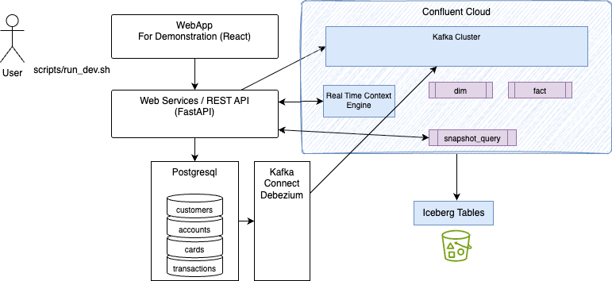
</figure>

* Be sure to have the Confluent Cloud resources created with Terraform. To do this deployment see the [SRE doc](./sre_ccloud_tf.md)

* Start the local Postgresql server
    ```sh
    # With creation of tables and creates some records
    ./IaC/local/start_local_pg_server.sh --seed
    # restarting an existing instance
    ./IaC/local/start_local_pg_server.sh 
    ```

    You should get some report like:
    ```
    ┌─────────────────────────────────────────────────────────┐
    │  Local PostgreSQL connection details                    │
    ├─────────────────────────────────────────────────────────┤
    │  Host     : localhost                                   │
    │  Port     : 5432                                        │
    │  Database : c360db                                      │
    │  User     : dbadmin                                     │
    │  Password : localdevonly                                │
    └─────────────────────────────────────────────────────────┘
    ```

* Set environment variables to access Confluent Cloud resources, like Kafka, schema Key/secrets and bootstrap address. This can be done by looking terraform output:
    ```sh
    source ./scripts/set_env_from_tf.sh
    ```

    or using your own scripts to get environment variables preset, to an existing Confluent Cloud environment.

* Set where to find the specific `.env` file. You can use different .env file and reference it via environment variable:
    ```sh
    export ENV_CONFIG_FILE=$PWD/apps/backend/.env
    ```
* Start Debezium Server
    ```sh
    ./IaC/local/start_debezium.sh 
    ```

    You should get:
    ```sh
    Ensuring Connect metadata topics exist …
    Pulling Debezium image (if not cached) …
    Starting Debezium worker on port 8083 …
    Waiting for the Connect REST API …
    Connect REST API is ready (4s).
    Applying connector 'postgres-cdc' …
    ✅ Connector 'postgres-cdc' is RUNNING.

    Connect REST API : http://localhost:8083
    PostgreSQL       : ......:5432/c360db (publication c360_cdc_publication, slot debezium_slot)
    Kafka            : pkc......us-west-2.aws.confluent.cloud:9092
    Topics           : cdc.public.customers, cdc.public.accounts, cdc.public.cards, cdc.public.transactions

    Status : curl -s http://localhost:8083/connectors/postgres-cdc/status | jq
    ```

    The last curl command returns

    ```json
    {
        "name": "postgres-cdc",
        "connector": {
            "state": "RUNNING",
            "worker_id": "192.168.64.63:8083"
        },
        "tasks": [
            {
            "id": 0,
            "state": "RUNNING",
            "worker_id": "192.168.64.63:8083"
            }
        ],
        "type": "source"
    }
    ```

## Demonstration Scenarios

**[Optional]** to demonstrate the integration with Real-time context engine using local LLM. 

* Download [omlx](https://omlx.ai/) or ollama
* Download one of the models from Huggingface: `Ornith-1.5-9B-MLX-8bit`

    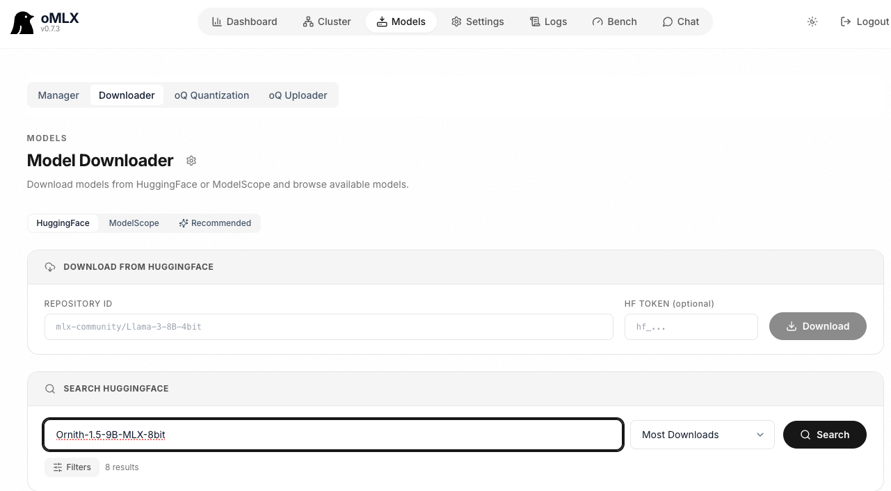

* Start the server
    ```sh
    omlx start
    ```


### 1. Go to the web app

[Web page is http://localhost:5173/](http://localhost:5173/)

### 2. Deploy the Flink Statements / Materialized Tables

* Deploy the Flink statements using dbt
    ```sh
    cd pipelines
    source .venv/bin/activate
    # verify the Confluent dbt version, if needed, update, change in pyproject.yaml in pipelines folder
    dbt version
    # Deploy the c360 data product from the fact tables to the parents
    dbt run --select +c360.facts
    # Deploy crm
    dbt run --select +crm.facts
    # Deploy fraud
    dbt run --select +fraud.facts
    # Individual table can be deployed too
    dbt run --select c360.dimensions.dim_transactions
    ```

* Once all materialized tables are deployed, we need to enable RTCE on the fact table. There is a separate terraform to do so.
    ```sh
    cd IaC/rtce
    terraform apply
    ```

    Should output:
    ```sh
    Apply complete! Resources: 5 added, 0 changed, 0 destroyed.

    Outputs:

    rtce_lightning_api_key_id = "IOGMHHDUI22T7GPE"
    rtce_lightning_api_key_secret = <sensitive>
    rtce_lightning_sa_id = "sa-r2z9987"
    rtce_c360_profile_topic_name = "fct_c360_profile"
    rtce_crm_summary_topic_name = "fct_crm_summary"

    ```

    Verify in the console that the `fct_c360_profile` and `fct_crm_summary` topics are enabled:

    <figure markdown='span'>
    
    </figure>

* Update environment variables to be able to get the Global key and secret needed to run lightning queries and real-time context engine:
    ```sh
    CONFLUENT_GLOBAL_KEY=$(terraform output -raw rtce_lightning_api_key_id)
    CONFLUENT_GLOBAL_SECRET=$(terraform output -raw rtce_lightning_api_key_secret)
    ```

    or to also modify the backend .env file rerun:
    ```sh
    ./scripts/set_env_from_tf.s
    ```


#### Customers Management

The customers page presents a list of existing customers loaded from the database:

<figure markdown='span'>

</figure>

Each 
It is possible to add a new customer, with the Add customer button, or view, update, delete an existing customer using the action icon.

For example selecting the eye icon on James Carter brings this view:

<figure markdown='span'>
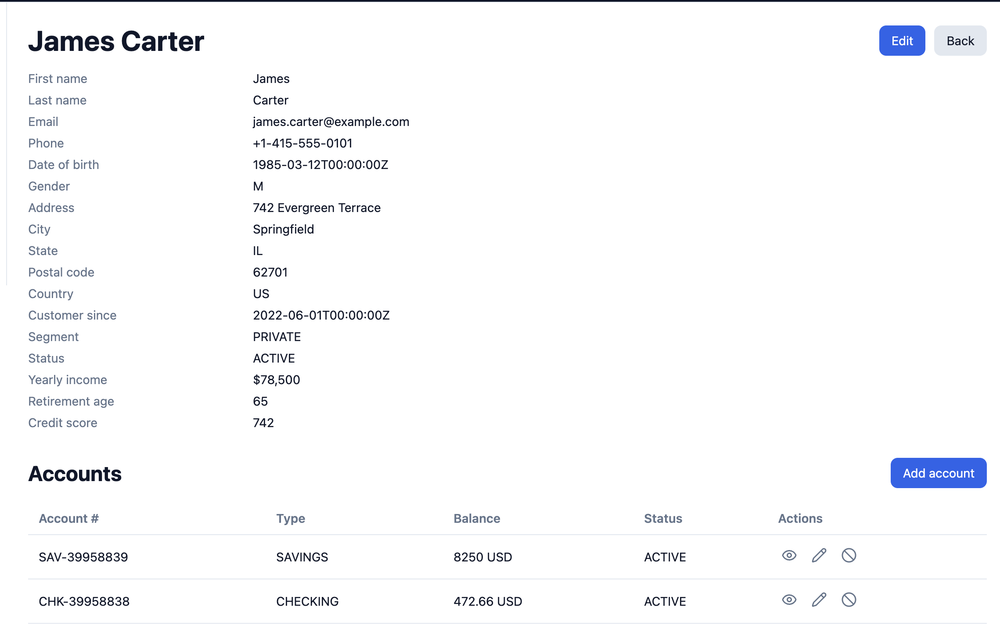
</figure>

A customer may have 0 to n accounts.

#### Accounts Management

The accounts are managed from a customer edit, by adding new accounts. 

#### Use Assistant to query an existing customer

1. Go to Assistant page and enter in the chat:
    ```
    what is the profile of jennifer walsh?
    ```

2. Here is the current state:
    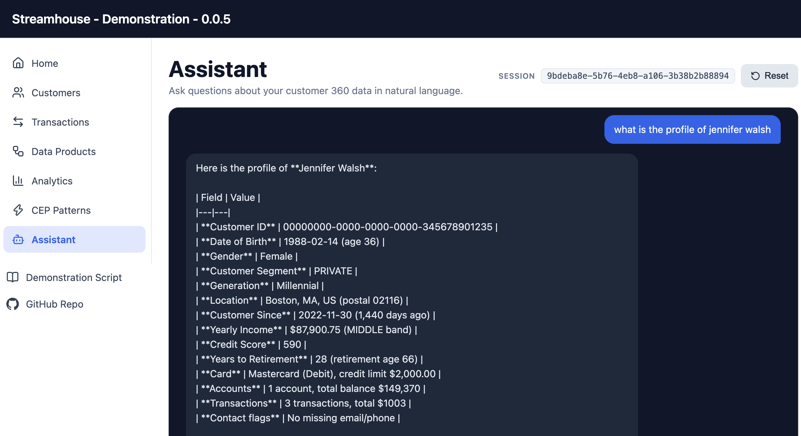

We will add a transaction to see the change propagated to the fact tables.

***This part is showing a dedicated AI agent, defined with tools to query the Confluent Real-time context engine, exposed as MCP server, and querying the Lightning table of the fct_c360_profile topic***

#### Transaction Management

The transactions page presents a list of current transactions in the database:

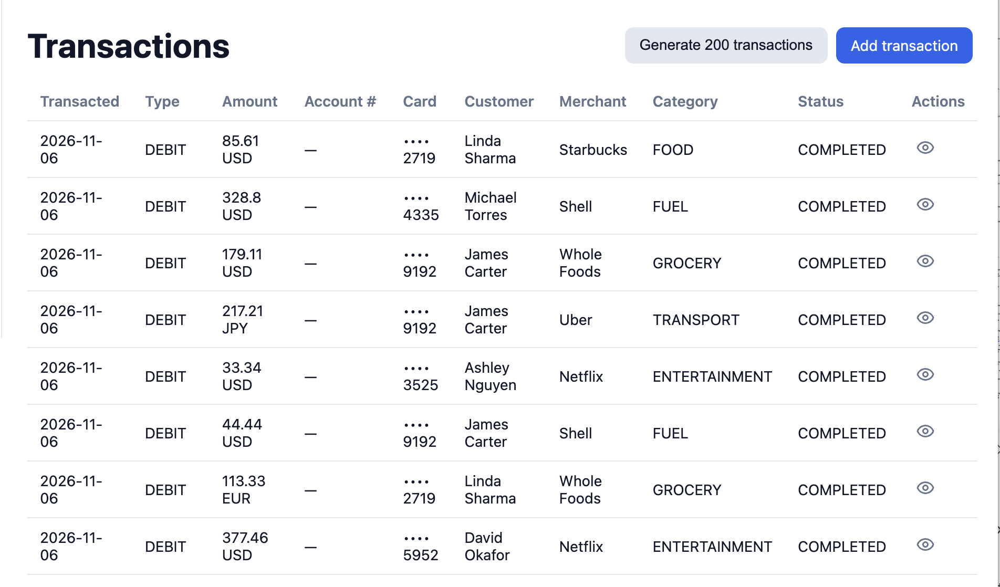

Again this is for demonstration purpose.

* It is possible to create a transaction manually to test the updates to the fact tables. Here are some valuable data for demonstration:

    * Account: CHK-31429110 (of Jennifer,Walsh with id 345678901235)
    * Select the credit card
    * Enter POS transaction for a RETAIL.

    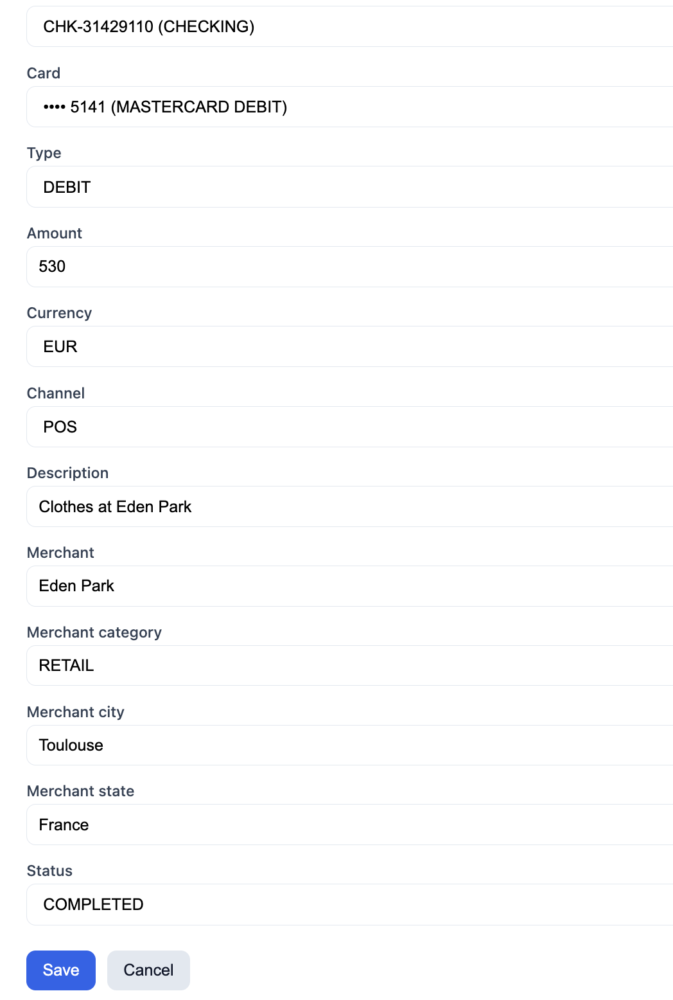

    * Running the following snapshot query in Confluent cloud workspace:
    ```sql
    select * from `cdc.public.transactions` where `customer_id` = '00000000-0000-0000-0000-345678901235'
    ```

    will display all Walsh's transactions.

    * Finally using the Analytics page, and the top dashboard to do the snapshot query on the c360 profile fact table we get the new balance ($1533) and the new transaction count (4):

    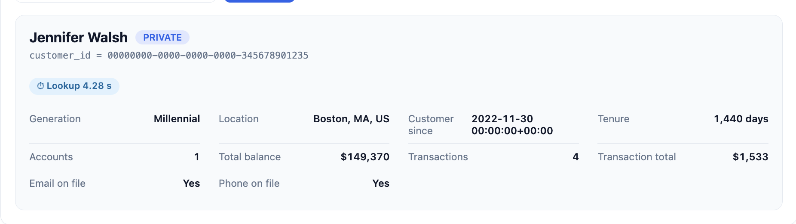 

* To simulate a week of activity, click **Generate 200 transactions**. The backend creates 200 transactions on existing accounts, timestamped from 7 days ago in 15-minute increments, inserts them in Postgres, and Debezium publishes them to the `cdc.public.transactions` topic. The page then shows the newly created transactions.

### Data products view

This page demonstrates the presentation of Flink statement lineage and metrics per data analytics product. 

* First select the analytics product
    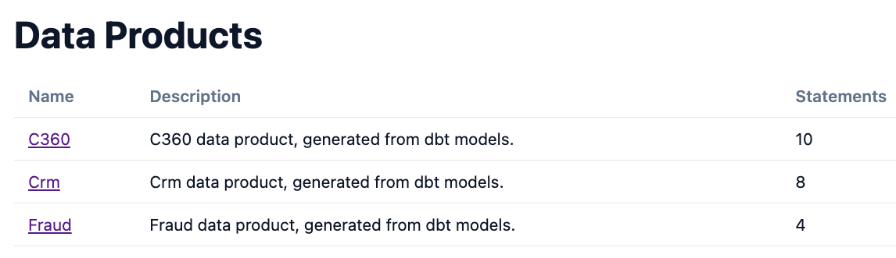

* See the pipeline graph for one of the fact table:
    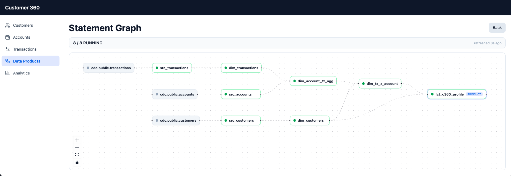

* User can drill down to see real-time metrics for on of the statement, and the deployed SQL query:
    

    The message in and out should be greater than 0 when there is record flowing into the topics.


### Analytics Dashboard

The Analytics page is an illustration of what can be done by directly accessing data in kafka

1. Get the aggregation cross customers. Rather than pulling every customer row and folding it in the backend, the cross-customer aggregates are built in Flink as a **CRM analytic data product** — four small materialized tables ( `fct_crm_by_segment`, `fct_crm_by_generation`, `fct_crm_by_gender`, `fct_crm_by_country`) derived from `dim_customers`, plus the fact tables `fct_crm_summary`, and `fct_c360_profile`. The backend reads them with six simple `SELECT *` **snapshot queries** run concurrently through the `confluent-sql` driver — the aggregation work stays in Flink and only the summary rows cross the wire. This is the Streamhouse pattern: build analytics products in Flink, expose them through a plain query.

    

    The backend also returns the elapsed time from a client point of view. A snapshot query spins up a Flink statement, so each runs in roughly 5–8s; the five run concurrently so the dashboard load is bounded by the slowest, not their sum.

1. Use the snapshot query, which creates a Flink Statement, to get a data for a user:

    

    Same as above the query now has where condition on the customer name.

1. We can do the same query with the new Real-time context engine, lightning query:
    

    We can see that it gets results in 227ms.

### Demonstrate Real-time Context Engine

There is a local LLM running in the background listening on http://localhost:7999/v1, so a OpenAPI compatible protocol. The backend is running an Agent with MCP tool defined in code, and the user interface support chatting with the customer 360 profile topic:

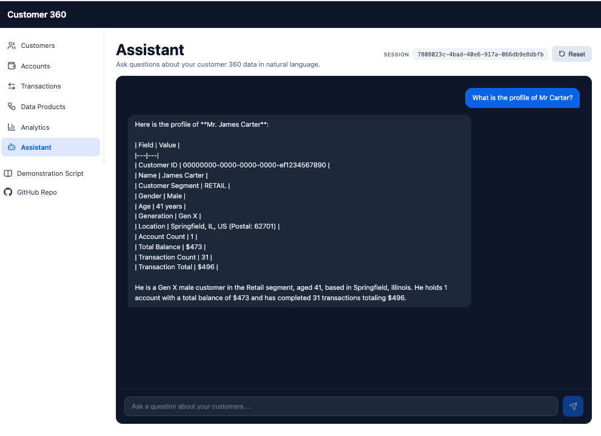

* Examples of query to ask:
    - What is the profile of Mr Carter?
    - what about Mrs Walsh profile?
    - What is the current CRM metrics?


### Complex Event Processing

There are few Flink statements with sink as materialized table that are using the MATCH_RECOGNIZE function. To demonstrate those logics, we need controlled data. The CEP Patterns page offers 3 different scenarios:

* **Fraud Probe:** Card-cloning telltale: a $2.99 verification charge on Carter's CHECKING account is immediately followed by two large charges ($899 + $749). Carter's SAVINGS account gets a benign $45 grocery charge that must NOT trigger the pattern — demonstrating per-account isolation.

    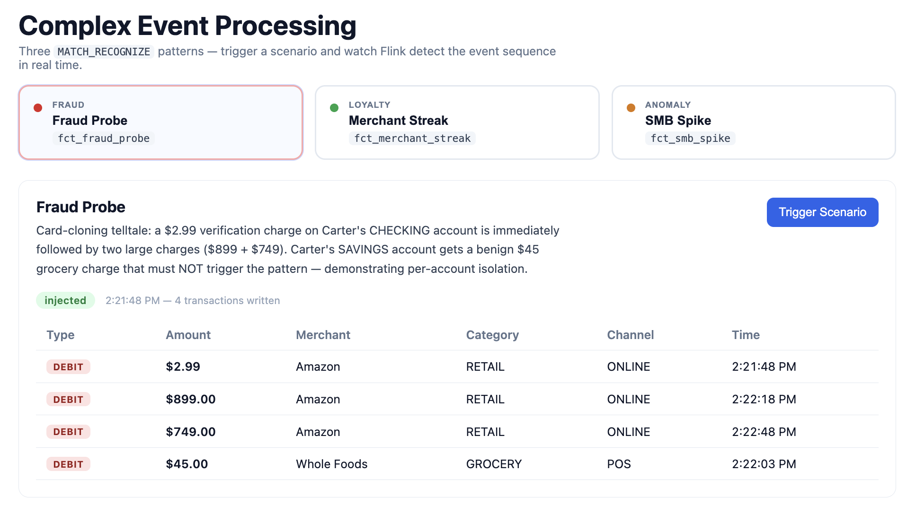

* **Loyalty signal:** Maria Gonzalez makes 3 consecutive FOOD transactions within 10 minutes — coffee, team lunch, client dinner — triggering the merchant-streak pattern. Useful for personalised offers.

    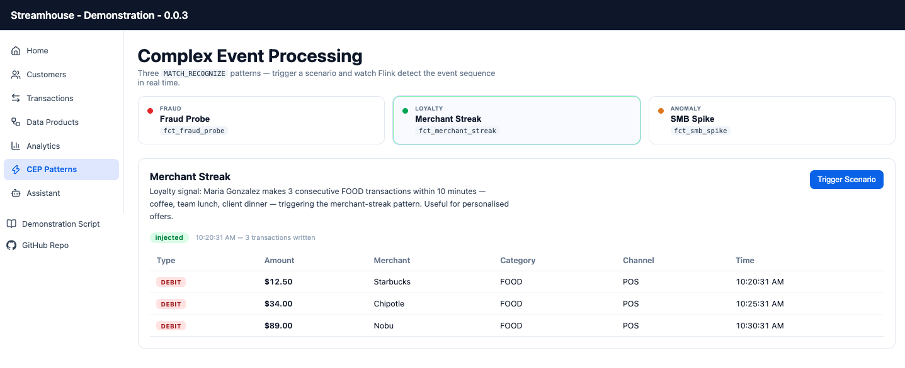

* **SMB Spike:** Business expense anomaly: David Okafor (SMB) makes three large charges ($420 office supplies, $380 cloud software, $610 hardware) followed by a $1,200 expense reversal — all within 15 minutes. Flags the account for relationship-manager review.

    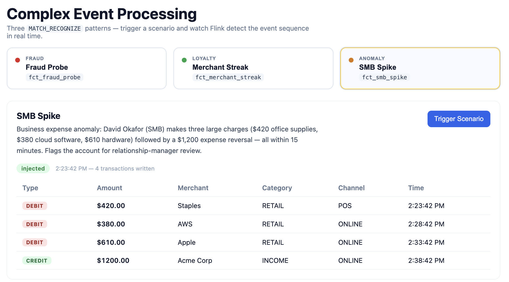

TBC

### Verify data are in Postgresql tables. 

* Start a session in psql:
    ```sh
    container exec -it c360-postgres psql -U dbadmin -d c360db
    ```

    ```sql
    -- Row counts for all three tables
    SELECT 'customers'   AS tbl, COUNT(*) FROM customers
    UNION ALL
    SELECT 'accounts'    AS tbl, COUNT(*) FROM accounts
    UNION ALL
    SELECT 'transactions'AS tbl, COUNT(*) FROM transactions;

    -- Sample a customer with their accounts
    SELECT c.first_name, c.last_name, c.email, c.segment,
        a.account_type, a.balance
    FROM   customers c
    JOIN   accounts a USING (customer_id)
    LIMIT  10;

    -- Recent transactions
    SELECT t.transaction_type, t.amount, t.merchant_name,
        t.merchant_category, t.channel, t.status,
        t.transacted_at
    FROM   transactions t
    ORDER  BY t.transacted_at DESC
    LIMIT  10;

    -- Quit
    \q
    ```

