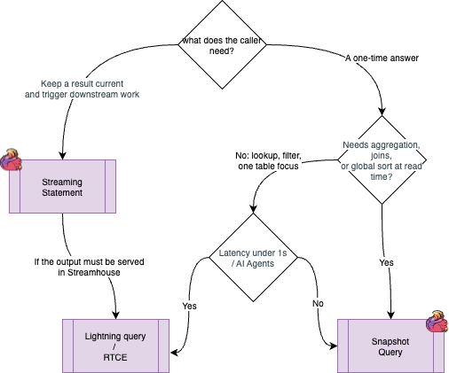
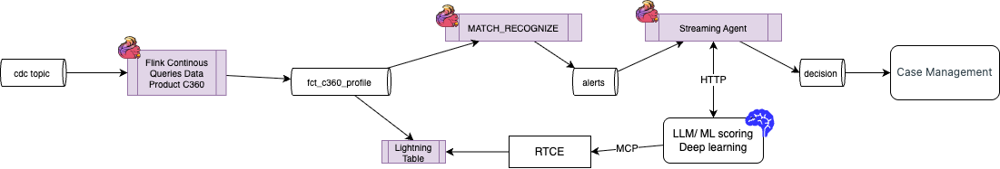

# Fit for Purpose

Once the Flink pipeline has materialized `fct_c360_profile` (and the CRM data products) in Kafka, there are several ways to *read* that data back, and one way to *act* on it continuously. They look similar from the outside (SQL in, rows out), but they are built for different jobs. This page helps a solution engineer pick the right one, and explains what to say when a customer asks "why not just use X?".

| Need | Use | Demo page |
|---|---|---|
| Serve one customer's current state to an app or an AI agent, in well under a second, from many concurrent clients | **Lightning query** (Lightning Tables, served by the Real-Time Context Engine) | *Lightning* widget, *Assistant* chat |
| Run an ad-hoc, analytical query (aggregations, joins, sorting) over a topic, once, and get a consistent answer | **Flink snapshot query** | *Snapshot* widget, analytics dashboard |
| **Continuously** compute, enrich or react to events as they arrive | **Flink streaming** statement (the dbt pipeline) | Statement graph |
| Let an **LLM reason and call tools on each event**, inside the stream | **Streaming Agents** (`CREATE AGENT` + `AI_RUN_AGENT`) | (not in the demo yet) |

!!! info "Sources"
    Facts below come from the Confluent Cloud documentation ([Lightning Tables](https://docs.confluent.io/cloud/current/lightning-tables/overview.html), [Query a Lightning Table](https://docs.confluent.io/cloud/current/lightning-tables/query/overview.html), [Real-Time Context Engine](https://docs.confluent.io/cloud/current/ai/real-time-context-engine/overview.html), [Snapshot Queries](https://docs.confluent.io/cloud/current/flink/concepts/snapshot-queries.html), [Streaming Agents](https://docs.confluent.io/cloud/current/ai/streaming-agents/overview.html)) and from what this demo's backend does. Lightning Tables and the Real-Time Context Engine are recent, fast-moving features: re-check limits, regions and pricing before quoting them.

## The three query modes in one picture

<figure markdown="span">

</figure>


The Confluent documentation compares them directly:

| | Lightning query | Snapshot query | Streaming query |
|---|---|---|---|
| **How it runs** | Runs once, returns in less than a second | Runs once, returns results, exits | Runs continuously, returns results incrementally |
| **Engine** | Managed table optimized for lookups, no Flink job | A Flink job in batch mode | A Flink job in streaming mode |
| **Best for** | Point lookups, range scans, full scans from many concurrent clients such as applications and AI agents. Select using primary key as index. | Complex, exploratory analysis over historical data | Processing data continuously as it arrives |
| **Cost model** | Usage-based: compute (CCU minutes), bytes scanned, storage | CFUs, same as streaming | CFUs while running |

## When to use Lightning query

### What it is

A **Lightning Table** is a managed materialization of a Kafka topic, optimized for fast lookups. You enable it per topic (Console, CLI, terraform or API). Confluent Cloud keeps it updated within 100 ms of new data arriving, with no consumers to write and no Flink job to run. The Real-Time Context Engine (RTCE) is the MCP (Model Context Protocol) interface to those same tables.

A Lightning query is read-only SQL on a *single* table, reachable through five interfaces that all read the same table:

| Interface | Auth | Typical client |
|---|---|---|
| Console | User login | Exploration |
| HTTP API (`https://sql.<region>.<cloud>.confluent.cloud/query/v1`) | Global API key (Basic) | Applications, dashboards, services (this demo's `lightning_client.py`) |
| MCP (RTCE) | Global API key, Confluent sign-in or OAuth | AI agents (this demo's *Assistant*) |
| Confluent CLI (`confluent lightning query`) | User login | Scripts |
| JDBC | Global API key | BI tools, Java apps |

### Choose it when

- **The consumer is an operational application or an AI agent** that needs the *current* state of one entity ("what is customer Carter's balance and segment *right now*?"), repeatedly and concurrently.
- **Latency is a requirement**, not a nice-to-have. A snapshot query spins up a Flink job each time; a Lightning query does not.
- **You do not want to run infrastructure**: no compute pool sizing, no cache, no serving database in front of Kafka.
- **The reader should not know Kafka**: a business user or an LLM asks for data and gets rows. The RTCE exposes exactly three MCP tools, `listTopics`, `getMetadata` and `queryData`, and the documented agent workflow is discover, inspect, then query.
- **You need data that has aged out of the topic.** A Lightning Table persists independently of the topic's retention policy, so it can return records that Kafka has already deleted.

### Be careful when

| Constraint | Detail |
|---|---|
| **Single-table, read-only SQL** | Supports key lookups, `WHERE` filters (`=`, `!=`, `<`, `IN`, `LIKE`, `BETWEEN`, `IS NULL`, `AND`/`OR`), column selection, `ORDER BY` and `LIMIT`. **No** aggregates (`COUNT`, `SUM`...), `GROUP BY`, joins, subqueries, set operators, DDL or DML. |
| **Result size and time** | Over MCP: at most **200 rows** and a **20 s** timeout; `max_result_rows` is mandatory on every `queryData` call; rate limiting returns `RATE_LIMIT_EXCEEDED`. The HTTP API returns small results inline (`200`) and large or slow ones asynchronously (`202` plus a statement ID to poll). |
| **Different data than Flink may see** | A Lightning query reads the *table*, not the topic, so it "might return different results than a Flink streaming or snapshot query on the same topic". Do not use it to reconcile against Flink output. |
| **Topic prerequisites** | Needs a registered schema (Avro, Protobuf or JSON Schema) and a Kafka record key, which the table uses as its primary key for deduplication. The key schema cannot change afterwards. |
| **Upsert vs append** | Mode follows `cleanup.policy`. `compact` plus a record key gives upsert (latest row per key, tombstones delete); `delete` gives append (all records). For "current profile per customer", you want upsert. |
| **Schema evolution** | Supported changes keep working; an unsupported one (for example a renamed column or a changed key schema) stops ingestion until you revert or move to a new topic. |
| **Credentials** | A **Global** API key (organization-wide). Cluster-, environment- or Flink-scoped keys return 401, which is why `lightning_client.py` calls this out. Also needs `DeveloperRead` on the topic and the Schema Registry cluster. |
| **Private networking** | Console and CLI queries do not work over private networking. Use API, MCP or JDBC through a private endpoint. |

### In this demo

- `fct_c360_profile` is the table behind the *Lightning* widget. The backend calls the HTTP API from [`analytics/lightning_client.py`](https://github.com/jbcodeforce/streamhouse_c360_demo/blob/main/apps/backend/analytics/lightning_client.py) with a Global key, `catalog_name` = environment ID and `database_name` = cluster ID. It is best-effort: missing credentials or a non-2xx answer yield no rows rather than an exception.
- The *Assistant* chat uses the RTCE MCP endpoint through an Agno agent, to show a business user asking a question in natural language and getting live Kafka data, with no pipeline code in between.

!!! tip "Talk track"
    "Flink did the hard work once, continuously: it joined, deduplicated and aggregated into one profile row per customer. Lightning makes that row servable: the app or the agent asks, and gets an answer in milliseconds. Same Kafka topic, no cache, no extra database."

## When to use Flink Snapshot Query

### What it is

A snapshot query is an ordinary Flink SQL statement with one extra property, `sql.snapshot.mode = 'now'`. Flink switches to batch mode, bounds every input at the current moment (`AS OF NOW()`), computes the result, releases its resources and exits. You cannot query an arbitrary past point in time yet. It works on Kafka topics, including ones with Tableflow enabled, but not on Iceberg or Delta tables that Tableflow write.

It can be launched from the Console (the *Mode* dropdown), SQL (`SET 'sql.snapshot.mode' = 'now';`), the REST Statements API (`spec.properties`), Terraform, the Table API, or `confluent flink query` (which sets the property for you).

### Choose it when

- **The question needs the full SQL engine**: `GROUP BY`, joins across topics, window or analytic functions, global `ORDER BY`. Batch mode enables global sorting, blocking operators and efficient joins that streaming cannot offer.
- **You are exploring** a new dataset before committing to a streaming pipeline, or debugging ("what does the data look like right now?").
- **You need a consistent, deterministic answer**: the default isolation level is `read-committed`, aligned with Kafka exactly-once semantics, so results are free of partial or aborted writes, and rerunning on the same data gives the same result.
- **You want reports, audits or reconciliations** against what is actually in the topic.
- **A handful of callers, an occasional call**, where a few seconds of latency is acceptable. The demo's analytics dashboard fits: five trivial `SELECT *` on pre-aggregated `fct_crm_*` tables, run concurrently, with the aggregation already done in Flink.

### Be careful when

| Constraint | Detail |
|---|---|
| **Latency** | Each query is a statement submitted to a compute pool, so it pays job start-up and result polling. Expect seconds rather than milliseconds (measure it in your own environment, the docs give no figure). |
| **Concurrency** | Every call consumes compute (billed in **CFUs**, like streaming). It is not a serving layer for thousands of simultaneous users. |
| **Not a pipeline** | It runs once and exits. If the result must stay current, use a streaming statement writing to a topic, then read that topic. |
| **A plain `SELECT` needs a consumer** | Via `statement create` (without `confluent flink query` or the SQL driver fetching rows), nothing reads the result and Confluent Cloud stops the statement after five minutes. |

### In this demo

- The *Snapshot* widget and the analytics dashboard run snapshot queries through the `confluent-sql` DB-API driver (`analytics/confluent_sql_client.py`, `analytics/crm_provider.py`).
- Putting the aggregation in Flink (`fct_crm_*`) and doing only `SELECT *` at read time is deliberate: do the heavy lifting in the stream, keep the read trivial. That is also what makes the Lightning variant possible, because Lightning cannot aggregate.

!!! tip "Talk track"
    "Snapshot is for the analyst and the engineer: full Flink SQL, consistent, pay for what you run. Lightning is for the app and the AI agent: one row, fast, many callers. Use the first to *understand* the data, the second to *serve* it."

## Choosing between them

<figure markdown="span">

</figure>

| Question | Lightning | Snapshot |
|---|---|---|
| Latency target | Sub-second | Seconds |
| Many concurrent callers | Designed for it | Poor fit (one Flink job per call) |
| Aggregations, joins at read time | No | Yes |
| Data aged out of retention | Yes | No (reads the topic) |
| Result size | Small (200 rows over MCP) | Large possible |
| Runs infrastructure you size | No | Compute pool (CFUs) |
| Natural client | App, AI agent, BI via JDBC | Analyst, notebook, batch job |
| Failure mode to know | Unsupported schema change halts ingestion | Statement stopped if nothing consumes the result |

**Rule of thumb**: model with Flink *streaming* so each topic already holds the shape the reader wants (one row per key, pre-aggregated). Then serve that topic with Lightning, and keep snapshot for the questions you did not model in advance.

## Flink Agents use cases

### What it is

**Streaming Agents** (part of Confluent Intelligence) are event-driven AI agents that run inside Flink SQL, on the data stream, instead of beside it. Everything is a first-class SQL resource:

```sql
-- 1. The tool: an MCP server or a Flink UDF
CREATE CONNECTION tx_mcp
WITH ('type' = 'mcp_server', 'endpoint' = '<tx-mcp-url>', 'api-key' = '<key>');

CREATE TOOL tx_tool USING CONNECTION tx_mcp
WITH ('type' = 'mcp', 'allowed_tools' = 'queryData,getMetadata', 'request_timeout' = '30');

-- 2. The agent: model + prompt + tools
CREATE AGENT tx_review_agent
  USING MODEL my_llm
  USING PROMPT 'You review a flagged card transaction. Look up the customer profile, decide APPROVE / REVIEW / BLOCK and explain briefly.'
  USING TOOLS tx_tool
  WITH ('max_iterations' = '5');

-- 3. Run it on every event
SELECT tx_id, response
FROM flagged_transactions,
LATERAL TABLE(AI_RUN_AGENT('tx_review_agent', `message`, `tx_id`, 'agent_system_table'));
```

Key building blocks, from the documentation:

| Capability | What it gives you |
|---|---|
| **Function call agent** | Declarative agent: role (prompt), capabilities (tools), model. The runtime runs the reason-and-act loop (`max_iterations`, default 20; `max_consecutive_failures`, default 3). |
| **Tools** | `CREATE TOOL` over a Flink **UDF** (runs locally in Flink, lowest latency) or an **MCP** / A2A server (external services). `allowed_tools` restricts what the agent may call. |
| **Models** | Any model you register with `CREATE MODEL` / `CREATE CONNECTION`: OpenAI, AWS Bedrock, AWS SageMaker, Google Vertex AI, Azure AI Foundry. |
| **Reflection workflows** | A drafter agent and a critic agent loop until the critic approves (`pass_condition` of `approval` or `confidence`) or the iteration limit is hit. |
| **Context management** | Token strategies `none`, `trim` or `summarize` when a conversation exceeds `max_tokens_threshold`. |
| **Observability & replay** | A *system log table* captures every chat message, model response, tool call and error; replay lets you test a new agent version against history without side effects. |
| **Console** | Create and manage agents without writing SQL. |

### Choose it when

- **The trigger is an event**, not a person typing. The agent fires for every flagged transaction, support ticket or sensor reading.
- **The decision needs judgment over context** that a rule or `MATCH_RECOGNIZE` pattern cannot encode: free text, ambiguous signals, multi-step lookups.
- **The result belongs back in the stream**: the agent's output is a new row/topic that downstream statements, Tableflow or applications consume.
- **You want governance and auditability** of AI behavior (traceable tool calls, replay) rather than ad-hoc scripts.

### Use cases (and how they map to this demo)

| Use case | Event that triggers the agent | Context the agent fetches | Output |
|---|---|---|---|
| **Fraud triage** | A row from `fct_fraud_probe`, `fct_merchant_streak` or `fct_smb_spike` (the `MATCH_RECOGNIZE` models) | Customer profile from `fct_c360_profile` through RTCE/Lightning. Recent history | Verdict (approve / review / block), rationale, recommended action |
| **Next-best-action / personalization** | A change to a customer's segment, balance or activity in `fct_c360_profile` | Profile, product catalogue (MCP or external table) | Tailored message or offer, written to a topic for the CRM |
| **Customer-service automation** | A new support ticket or chat message | Account lookup tool (UDF), ticket system (MCP) | Draft reply, routing decision, ticket creation |
| **Data-quality stewardship** | A customer record that fails validation rules (illustrative, not in the pipeline today) | Related rows, reference rules | Corrected record or exception ticket |
| **IoT / predictive maintenance** | Sensor window breaching a threshold | Equipment history | Maintenance work order |
| **Content moderation / enrichment** | New user-generated text | Policy documents | Category, severity, `AI_SENTIMENT` style tags |
| **Compliance review** | High-value or unusual transfer | Customer risk profile | Case summary for an analyst, using a reflection agent for quality |

The pattern that ties it together in this repository: Flink CEP detects, Lightning/RTCE supplies fresh context, the Streaming Agent decides. That is the "art of the possible" story in three layers, all on one Streamhouse platform.





### Be careful when

- **Do not use an agent where deterministic SQL is enough.** A rule such as "amount > 5000 and new merchant" is cheaper, faster and reproducible as a Flink statement. Use the agent for the residual ambiguous cases, after the cheap filter.
- **LLM calls are slow and billed per token.** Throughput of an agent statement is bounded by model latency and rate limits; filter upstream so only the interesting events reach `AI_RUN_AGENT`, and size `max_iterations` and `request_timeout` to the task (a chatbot needs seconds; a research agent minutes).
- **Make tools idempotent.** The runtime retries (with exponential back-off for rate limits), so a tool that creates a ticket must tolerate being called twice.
- **Prefer UDF tools for high-frequency calls**, MCP tools for external systems.
- **Mind the data path of the context.** An agent that queries the RTCE through `queryData` gets at most 200 rows and 20 s per call, so give it narrow, key-based questions, not scans.
- **Treat prompts and tool inputs as untrusted.** Restrict `allowed_tools`, keep API keys in connections, and review the system log table.
- **Maturity**: Streaming Agents and Lightning Tables are new Confluent Intelligence capabilities; syntax and limits are still evolving. The statement graph and the dbt pipeline already cover the deterministic path, so position agents as the *next* layer, not a replacement.


## References

- Confluent Cloud: [Lightning Tables](https://docs.confluent.io/cloud/current/lightning-tables/overview.html), [Lightning query overview](https://docs.confluent.io/cloud/current/lightning-tables/query/overview.html), [SQL reference](https://docs.confluent.io/cloud/current/lightning-tables/query/sql-reference.html), [API](https://docs.confluent.io/cloud/current/lightning-tables/query/api.html), [MCP](https://docs.confluent.io/cloud/current/lightning-tables/query/mcp.html), [Limitations](https://docs.confluent.io/cloud/current/lightning-tables/limitations.html), [Monitoring](https://docs.confluent.io/cloud/current/lightning-tables/monitor.html)
- Confluent Cloud: [Real-Time Context Engine](https://docs.confluent.io/cloud/current/ai/real-time-context-engine/overview.html)
- Confluent Cloud for Apache Flink: [Snapshot Queries](https://docs.confluent.io/cloud/current/flink/concepts/snapshot-queries.html), [Run a snapshot query](https://docs.confluent.io/cloud/current/flink/how-to-guides/run-snapshot-query.html), [Batch and stream processing](https://docs.confluent.io/cloud/current/flink/concepts/batch-and-stream-processing.html)
- Streaming Agents: [Overview](https://docs.confluent.io/cloud/current/ai/streaming-agents/overview.html), [Build and run](https://docs.confluent.io/cloud/current/ai/streaming-agents/create-and-run-streaming-agents.html), [Agent runtime guide](https://docs.confluent.io/cloud/current/ai/streaming-agents/agent-runtime-guide.html), [Examples](https://docs.confluent.io/cloud/current/ai/streaming-agents/streaming-agents-examples.html), [`CREATE AGENT`](https://docs.confluent.io/cloud/current/flink/reference/statements/create-agent.html), [`CREATE TOOL`](https://docs.confluent.io/cloud/current/flink/reference/statements/create-tool.html)
- Blog: [Unleash Real-Time Agentic AI: Introducing Streaming Agents on Confluent Cloud](https://www.confluent.io/blog/introducing-streaming-agents/)
- This repo: [Web app design](web_app_design.md), [Flink DSP](build_flink_dsp.md)
