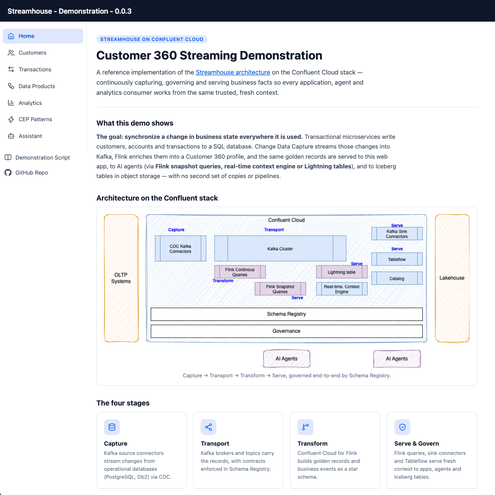
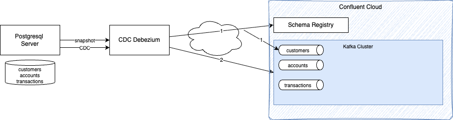
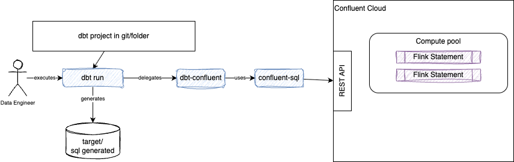
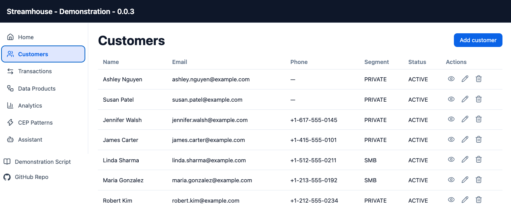
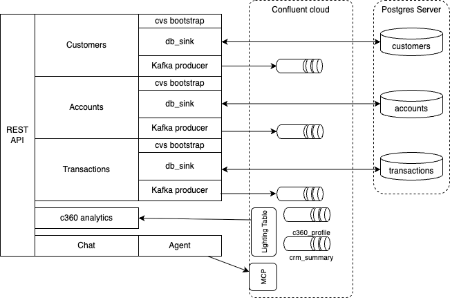

## Purpose

The purpose of this repository is to implement a Customer 360 streaming data pipeline that integrates operational databases (PostgreSQL, DB2, etc.) with event streaming, Change Data Capture (CDC), and modern lakehouse analytical sinks.

This is one possible demonstration of the [Streamhouse architecture](https://streamhouse.com) with Confluent Cloud products.

<figure markdown='span'>

<caption>**The home page of the application to drive the demonstration**</caption>
</figure>

From a business requirement point of view, **the goal is to demonstrate how to synchronize a change in business state everywhere it is used.**

The user story for the demonstration is:

> As a data architect, I want to deliver business entity updates to every system and person that depends on them, at the same time, so that no team operates on a **stale or conflicting copy** of that fact.

The Streamhouse data architecture continuously captures and processes changes as they happen, governs that data, and makes the same trusted business context available to applications, agents, and analytics without requiring additional data copies and pipelines.

At a high level, the Streamhouse reference architecture looks like the figure below:

<figure markdown='span'>

<caption>Streamhouse Capabilities</caption>
</figure>

The architecture provides a capture layer that brings data into a centralized messaging platform, which transports and persists records defined by structured schemas. A layer of transformation, data enrichment, and data analytics constructs serves golden records to downstream processing. Those golden records, which represent valuable business events or data analytics products, can be consumed by AI agents to build their own fresh context.

When the architecture is applied to the Confluent technology stack, Streamhouse is supported by the following components:

<figure markdown='span'>

<caption>Streamhouse With Confluent Cloud</caption>
</figure>

1. **Capture** is done by different Kafka source connectors.
1. **Transport** is supported by Kafka brokers and topics, with contracts in Schema Registry.
1. **Transform** is done by Confluent Cloud for Flink, with stateless or stateful logic to build golden records and business events.
1. **Serve** is supported by Flink snapshot queries, Kafka sink connectors, and Tableflow, which writes Iceberg tables to object storage. The Real-Time Context Engine is also a serving layer for AI agents.
1. **Governance** is done by Schema Registry and other end-to-end governance capabilities.

## Capabilities demonstrated

### Hybrid ingestion

One path of the demonstration runs the database and the Debezium connector on local servers (the user's laptop, to keep the demonstration simple). The CDC connector is connected to a Confluent Cloud Kafka cluster, creates the expected topics and schemas, and then processes changes from the source database into the Kafka topics:

<figure markdown='span'>

<caption>Hybrid ingestion from local servers</caption>
</figure>

[See this note](./local_cdc.md) for details on how to run this approach.

### CDC Managed Connector

The alternative to the previous deployment is to make the database accessible from the Confluent Cloud VPC and use a managed connector deployment.

* [See this note for Terraform-based deployment](./sre_ccloud_tf.md#defining-confluent-cloud-resources-with-the-terraform)
* [See this note for Confluent Cloud Console-driven deployment](./sre_ccloud.md#create-debezium-cdc-v2-kafka-connector)

### Infrastructure as Code

The Confluent Cloud resources (Kafka cluster, default topics, service accounts, role bindings, API keys, and secrets) are created with Terraform.
One important aspect of the deployment is to isolate data products in their own compute pools, and to run Flink snapshot queries on at least one separate compute pool:


<figure markdown='span'>

<caption>Flink compute pools - clear separation of concerns</caption>
</figure>

[See this note for details](./sre_ccloud_tf.md)

### CDC envelope automatic processing to upsert tables

When tables are created by the Debezium connector, their `changelog.mode` is set to `retract` if the source table in the SQL database has no primary key.

```sql
WITH (
  'changelog.mode' = 'retract',
  'kafka.cleanup-policy' = 'delete',
  'key.format' = 'avro-registry',
  'scan.startup.mode' = 'earliest-offset',
  'value.format' = 'avro-debezium-registry'
)
```

It is still possible to alter the default settings so developers can work on the CDC envelope and operation. This pattern is demonstrated for `cdc.public.customers` in [this SQL](https://github.com/jbcodeforce/streamhouse_c360_demo/blob/main/pipelines/models/crm/sources/src_customers.sql):

```sql
 SELECT
    customer_id,
    coalesce(IF(op= 'd', before.first_name, after.first_name), 'NULL') as first_name,
    coalesce(IF(op= 'd', before.last_name, after.last_name), 'NULL') as last_name,
    coalesce(IF(op= 'd', before.email, after.email), 'NULL') as email,
    coalesce(IF(op= 'd', before.phone, after.phone), 'NULL') as phone,
    TO_TIMESTAMP_LTZ(IF(op= 'd', before.date_of_birth, after.date_of_birth), 'yyyy-MM-dd''T''HH:mm:ss.SSSSSS''Z''') as date_of_birth,
    coalesce(IF(op= 'd', before.gender, after.gender), 'NULL') as gender,
    TO_TIMESTAMP_LTZ(IF(op= 'd', before.created_at, after.created_at), 'yyyy-MM-dd''T''HH:mm:ss.SSSSSS''Z''') as registration_date,
    coalesce(IF(op= 'd', before.segment, after.segment), 'NULL')   as customer_segment,
    TO_TIMESTAMP_LTZ(IF(op= 'd', before.customer_since, after.customer_since), 'yyyy-MM-dd''T''HH:mm:ss.SSSSSS''Z''') as customer_since,
    coalesce(IF(op= 'd', before.city, after.city), 'NULL') as city,
    coalesce(IF(op= 'd', before.state, after.state), 'NULL') as state,
    coalesce(IF(op= 'd', before.postal_code, after.postal_code), 'NULL') as postal_code,
    coalesce(IF(op= 'd', before.country, after.country), 'NULL') as country,
    `$rowtime` as event_ts
    FROM {{ source('cdc', 'customers') }}
```

### dbt deployment, materialized and streaming tables

Confluent has developed two Python modules: [`dbt-confluent`](https://pypi.org/project/dbt-confluent/) (adapts dbt-core to Confluent Cloud) and [`confluent-sql`](https://pypi.org/project/confluent-sql/) (a Python DB-API 2.0 compatible driver that runs snapshot and streaming queries with different cursors).


<figure markdown='span'>

<caption>dbt confluent plugin to deploy Flink streaming queries</caption>
</figure>

All the Flink statements presented in this repository are deployed using Confluent dbt. Project management is complemented by other personal CLIs.

[See this note](./flink_deployment.md) to review the development approach and deployment pattern using dbt for this solution.

[See Confluent dbt product documentation.](https://docs.confluent.io/cloud/current/flink/operate-and-deploy/deploy-flink-dbt.html)

### Lateral snapshot join on slow-moving, seeded data

A common data enrichment pattern is to join streaming records with reference data, which changes less frequently. There are multiple ways to support this integration, but in Confluent Cloud it is best to deploy the reference data in a Kafka topic so it can be reused for any enrichment. The [new lateral snapshot feature in Flink](https://docs.confluent.io/cloud/current/flink/reference/queries/joins.html#lateral-snapshot-joins) helps with these kinds of joins.

The reference data is defined in the [pipelines/seeds](https://github.com/jbcodeforce/streamhouse_c360_demo/blob/main/pipelines/seeds) folder and deployed simply by running:
```sh
dbt seed
```

* [seeds/country_codes.csv](https://github.com/jbcodeforce/streamhouse_c360_demo/blob/main/pipelines/seeds/country_codes.csv) has 249 ISO 3166-1 countries with alpha-2 code, alpha-3 code, numeric code, and name. The `country_code` key matches `customers.country`.
* [seeds/currency_codes.csv](https://github.com/jbcodeforce/streamhouse_c360_demo/blob/main/pipelines/seeds/currency_codes.csv) has 178 ISO 4217 currencies with code, numeric code, and name. The `currency_code` key matches `transactions.currency`.
* [seeds/seeds.yml](https://github.com/jbcodeforce/streamhouse_c360_demo/blob/main/pipelines/seeds/seeds.yml) adds descriptions, plus `unique` and `not_null` tests on the two key columns.

The snapshot lateral join query is implemented in the [transaction CDC processing]() with the following example:

```sql

```


### Snapshot query

dbt supports running materialized tables and streaming tables. The Confluent REST API exposes a "run Flink statement" operation that can also be used for snapshot queries. The backend application uses the [confluent-sql](https://pypi.org/project/confluent-sql/) module to demonstrate the integration inside a human-facing dashboard.

[See this Confluent client code](https://github.com/jbcodeforce/streamhouse_c360_demo/blob/main/apps/backend/analytics/confluent_sql_client.py#L51).

### Lightning query

The Confluent Cloud [Real-Time Context Engine]() (RTCE) exposes a Flink-maintained table for current-state point lookups over HTTP: a single synchronous POST returns the
table's current rows in milliseconds.

The request uses HTTP Basic auth with a dedicated *Global* resource API key (``CONFLUENT_GLOBAL_KEY``/``SECRET``,
provisioned by ``IaC/ccloud/lightning.tf``) and a body scoped by ``catalog_name`` = environment *ID* and ``database_name`` = Kafka cluster *ID* (IDs, not the display names that the Flink SQL Statements API uses).

See the [code reference](https://github.com/jbcodeforce/streamhouse_c360_demo/blob/main/apps/backend/analytics/lightning_client.py).

### Complex event processing for fraud detection

Because the use case is based on transactions, it is easy to demonstrate fraud detection patterns using Flink CEP capabilities.

### Chat with business data leveraging the Real-Time Context Engine

The frontend exposes a panel with a chat interface that demonstrates a local LLM calling a tool to query the Confluent Real-Time Context Engine for data exposed with Lightning tables.


<figure markdown='span'>

<caption>Chat with the Real-Time Context Engine</caption>
</figure>

### Flink pipeline lineage

The REST API and the dbt manifest help build a Flink statement pipeline lineage, by data analytics product. An illustration can be seen in the screenshot below:


<figure markdown='span'>

<caption>Flink Statement Graph</caption>
</figure>

The code that supports the implementation is in []()

### Billing aggregation

The frontend also exposes the monthly dollar amount per Flink pipeline:


<figure markdown='span'>

<caption></caption>
</figure>

### Others to finalize
* [ ] Sliding window aggregations over transactions grouped by cardholder (1-minute to 1-day windows).
* [ ] How to propagate delete operations to the sink bucket.
* [ ] Maintain data order for transactional systems.
* [ ] Iceberg table and Tableflow enabled in dbt.
* [ ] Tableflow catalog in sync with the AWS Glue Catalog.
* [ ] AWS Athena integrated with the AWS Glue Catalog for the defined Kafka cluster, so the Iceberg tables can be seen and queried.
* [ ] What monitoring and observability requirements exist?
* [ ] Add a page after *Assistant*: take the matches of `fct_fraud_probe`, call an agent whose only tool is the RTCE MCP server over `fct_c360_profile`, and write its verdict to a `fraud_decisions` topic that the UI polls. It reuses everything already in place (the scripted CEP scenarios, the Lightning Table) and shows the three modes cooperating instead of competing. 

### Architecture

The generic application behavior is:

* Microservice applications write to database tables.
* A PostgreSQL database server hosts the tables.
* The Debezium CDC Kafka connector creates one topic per table and defines the schemas in Schema Registry.
* A set of Flink queries prepares the data to build Customer 360 analytics metrics, which are served in sink topics.
* Sink topics are processed by Tableflow to export data as Iceberg tables / Parquet files into object storage.
* External catalogs are kept in sync with the Tableflow catalog.
* A web application supports demonstrating Streamhouse capabilities.

Two architectures are presented in this repository: one purely in the cloud, and one hybrid with a local server, database, and CDC feeding the Confluent Cloud Kafka cluster and Streamhouse:

=== "Hybrid cloud"

    This is the simplest deployment: the database and code run locally, with Confluent Cloud providing Kafka, Flink, Tableflow, and Streamhouse components.

    <figure markdown='span'>
    
    <caption>Local Database - Confluent Cloud Streamhouse</caption>
    </figure>

    * The PostgreSQL server runs locally in a container (on Mac; Docker Compose on Windows is not yet supported).
    * A Kafka Connect Debezium container image runs locally to capture changes from the 3 tables into the `cdc.public.*` topics.
    * The web app runs locally.

    The web app provides simple navigation to create, update, and delete customers and accounts. Transactions can only be created.

    <figure markdown='span'>
    
    <caption>Application Customers Page</caption>
    </figure>

=== "Cloud VPC to VPC"
    The end-to-end, more complex architecture looks like the following figure:

    <figure markdown='span'>
    
    <caption>Cloud Deployment - Confluent Cloud Streamhouse</caption>
    </figure>

    * The application runs on an EC2 host.
    * The PostgreSQL database server runs on AWS RDS.
    * The Debezium CDC Kafka connector is deployed as a managed service.
    * The Kafka cluster, Schema Registry, Real-Time Context Engine, Tableflow, and Flink jobs run on Confluent Cloud.

    ! Because it is more complex to deploy, this architecture is still under construction and testing.


#### Web app backend architecture

The web app and backend that support running the demonstration have the following components:

<figure markdown='span'>

<caption>Application High Level Component View</caption>
</figure>

* This emulates a microservice implementation in which each service is responsible for the life cycle of its own business entity. A future evolution is to implement the [CQRS pattern](https://jbcodeforce.github.io/eda-studies/patterns/cqrs/) and deploy each component as a standalone application.
* [See implementation details for developers who want to update this demonstration](./web_app_design.md)


---

## Actors

The Streamhouse architecture offers services for three different actors:

1. Site Reliability Engineer (SRE)
1. Data Engineer
1. Application Developer

### SRE

This use case demonstrates the tasks an SRE needs to perform to prepare an environment that supports the architecture above.

There are two ways to execute those tasks: via the Confluent Cloud Console, or via infrastructure as code using Terraform. The following bullet points are generic task descriptions that apply to both approaches (some are for production deployment only).

1. Create the Confluent Cloud environment, API keys and secrets, service accounts, role bindings, and Kafka cluster.
1. For production deployment, create a private network and a network link to Confluent Cloud.
1. Create a Schema Registry for a given environment.
1. Create a Flink compute pool.
1. Create source databases, for example, an RDS service with a PostgreSQL instance.
1. Create the Debezium CDC source connector for the database tables using Terraform.
1. Create the SQL tables in the selected PostgreSQL database: accounts, customers, and transactions.

*This list will be updated as this demonstration is implemented.*

### Data Engineer

The following steps are generic and may be supported by different tools:

1. Create a dbt project to manage Flink statements in a git repository. One approach is to use the star schema (see the note below).
1. Develop Flink queries using Confluent Cloud Workspace cells.
1. Save queries to files in the git repository and transform them for dbt.
1. Deploy the Flink logic using the dbt CLI: `dbt run`.

*This list will be updated as this demonstration is implemented.*

We recommend organizing the Flink statements using the [**star model**](http://jbcodeforce.github.io/flink-studies/cookbook/pm/?h=star+model#the-star-schema), a multidimensional data model used to organize data in a data warehouse. It denormalizes business data into dimensions and facts. The `fact` table sits at the center of the star schema and records *what* happened, as quantitative, measurable events. The `dimension` tables (the "context") surround the fact table and provide the who, what, where, when, and why.

### Application Developer

The following steps are generic and may be supported by different tools:

1. Define the contract for data and analytics, and the methodology for engaging with data engineers as part of the microservice design.
1. Maintain schema evolution with full transitivity.
1. Integrate data in Kafka via Lightning queries or snapshot queries.

*This list will be updated as this demonstration is implemented.*

* The web app, delivered as an MVP, illustrates the integration of these new query capabilities to serve data to applications.

--- 

## Sources for information

* [My living Flink study book](https://jbcodeforce.github.io/flink-studies/) with best practices, methodology, and code samples
* [Confluent Stream Processing with Confluent Cloud for Apache Flink](https://docs.confluent.io/cloud/current/flink/overview.html)
* [Streamhouse](https://streamhouse.com/) web site
